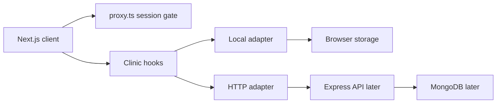
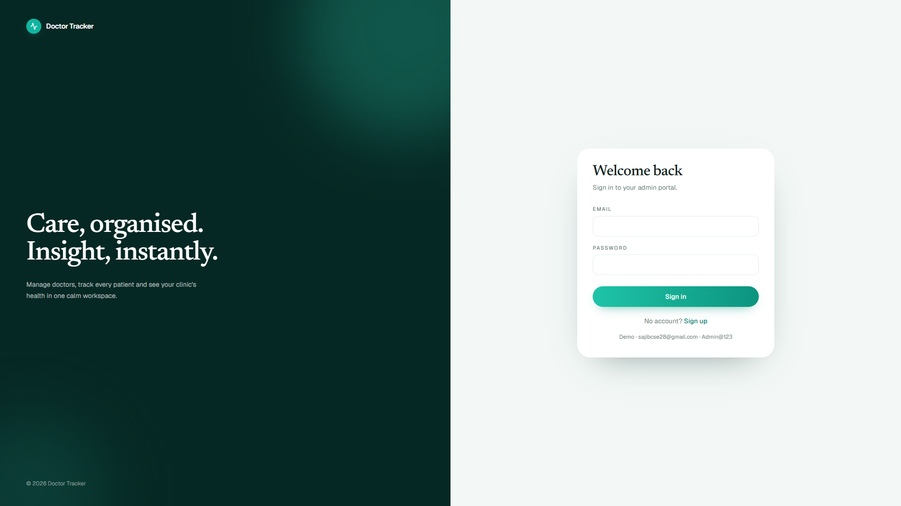
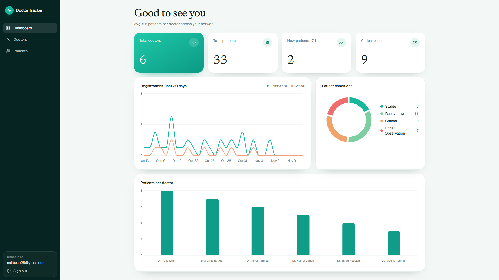
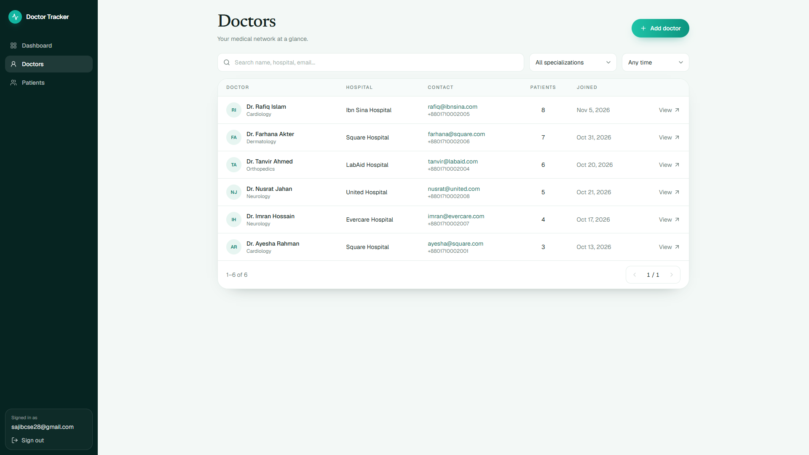
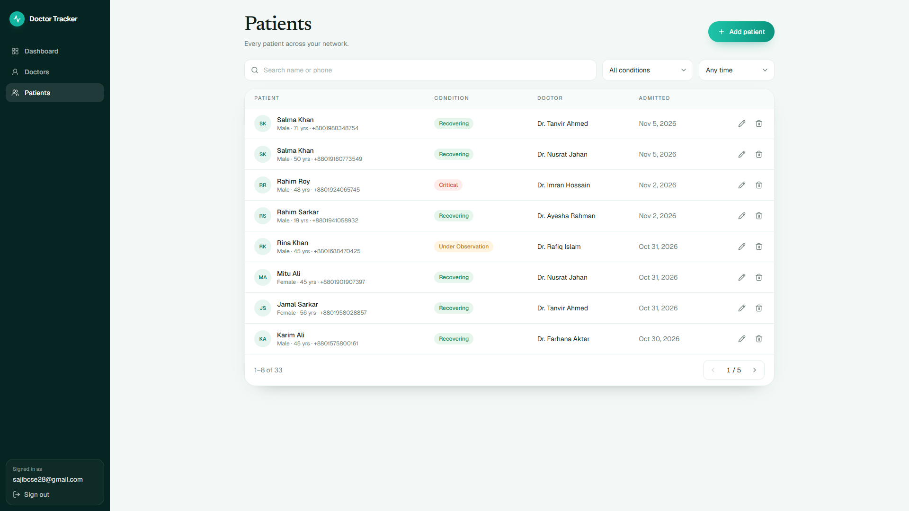
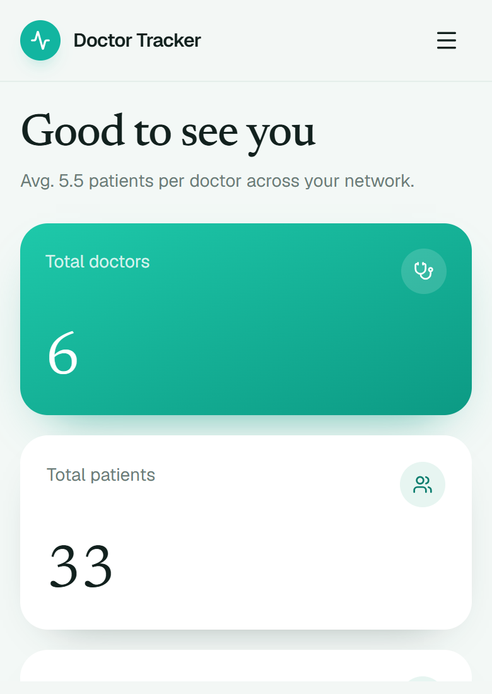
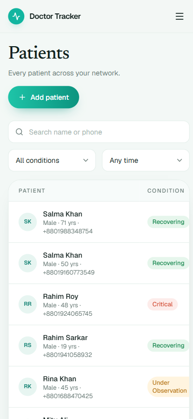

# Doctor Tracker

Doctor Tracker is a calm administrative workspace for clinic staff. Authenticated users manage a network of doctors, keep each doctor's patients up to date, and read the health of the network from a single dashboard: caseload, condition mix, and admissions over the last 30 days.

This repository is the Next.js client. It runs on its own today with a local data adapter, and it is ready to talk to a separate Node.js and Express API over REST when that service is added.

## Setup guide

Requirements: Node.js 20.9 or newer.

```bash
npm install
cp .env.example .env.local
npm run dev
```

Open [http://localhost:3000](http://localhost:3000).

`.env.example` is the template. Copy it to `.env.local` and leave the defaults while you are working without the API:

```bash
NEXT_PUBLIC_DATA_SOURCE=local
NEXT_PUBLIC_API_URL=http://localhost:4000
```

`local` stores accounts, doctors, and patients in the browser. Nothing else has to be running. When the Express service exists, set `NEXT_PUBLIC_DATA_SOURCE=remote` and point `NEXT_PUBLIC_API_URL` at it. The screens stay the same.

### Demo credentials

| Email | Password |
| --- | --- |
| sajibcse28@gmail.com | Admin@123 |

The sign-in card can fill these in. You can also create a separate account from Sign up. In local mode the password lives in the browser only, as a stand-in until the API hashes credentials.

## System architecture



1. `proxy.ts` checks the `dt_session` cookie before the dashboard, doctors, and patients routes render. Missing sessions return to sign-in. A session cookie on the sign-in pages continues to the dashboard.
2. Screens never read storage or `fetch` directly. They call hooks (`useDoctorPage`, `usePatientPage`, `useDashboardData`) that already accept search text, filters, date range, and page.
3. In local mode, pure query functions filter, sort, and paginate the clinic snapshot. The same query shape is what the HTTP adapter will send as query parameters.
4. Mutations update one clinic store. Dashboard totals, doctor caseloads, and both patient lists all read that store, so a new patient shows up everywhere without a second copy of the data.
5. The future Express service owns MongoDB. This client will send `Authorization: Bearer` and keep using `dt_session` only as the gate for the Next.js routes.

### REST contract for the API project

| Method | Path | Purpose |
| --- | --- | --- |
| POST | `/auth/login` | `{ email, password }` → `{ token, user: { id, name, email } }` |
| POST | `/auth/signup` | `{ name, email, password }` → same session shape |
| GET | `/doctors` | `search`, `specialization`, `range` (`any`, `7d`, `30d`, `90d`), `page`, `limit` |
| POST | `/doctors` | `{ name, specialization, hospital, phone, email }` |
| GET | `/doctors/:id` | One doctor, including `patientCount` |
| GET | `/patients` | `search`, `condition`, `doctorId`, `range`, `page`, `limit` |
| POST | `/patients` | `{ name, gender, age, phone, condition, doctorId, notes }` |
| PATCH | `/patients/:id` | Same body as create. Admission date stays put |
| DELETE | `/patients/:id` | `204` |
| GET | `/dashboard` | Totals, condition counts, patients per doctor, 30-day series |

List responses use `{ items, total, page, pageSize, pages, from, to }`. Doctor rows include `patientCount`. Patient rows include `doctorName`. Errors use `{ message }` and the matching HTTP status. Allow `Authorization` and `Content-Type` from the Next.js origin.

Suggested MongoDB indexes when you build that service:

- doctors: `{ email: 1 }` unique, `{ specialization: 1, joinedAt: -1 }`, text index on name, hospital, and email
- patients: `{ doctorId: 1, admittedAt: -1 }`, `{ condition: 1, admittedAt: -1 }`, `{ phone: 1 }`

## Technical decisions

### A clinic store instead of Redux

The client has one bounded cache: the signed-in user, the doctor list, and the patient list. Redux would add actions, reducers, and a provider for data that is about to move to the API. React context on its own was also a poor fit for the records, because copying `localStorage` into `useState` inside an effect re-renders the whole tree and fights hydration.

The records live in a small external store. React subscribes with `useSyncExternalStore`, which is the supported way to read a browser store without a hydration mismatch. Snapshots are cached and replaced only when a mutation commits, so a search keystroke does not clone the clinic. Context still exists, but only to hand the current snapshot and the four mutation functions to the screens. When the API is connected, those functions already call the HTTP client and bump a revision so the list hooks refetch. The screens do not change.

### Query objects now, MongoDB filters later

Search, specialization, condition, date window, and page size are arguments to `queryDoctors` and `queryPatients`, not ad hoc array filters inside each table. The local adapter runs those functions in memory. The HTTP adapter sends the same fields as query parameters. That keeps pagination and filtering correct for a few dozen local rows, and it gives the Express service a stable contract for indexed MongoDB queries. Components stay memoized around those inputs, so typing in the doctor search does not rebuild the dashboard charts.

Charts are derived with `buildDashboard` from the same records. There is no second analytics state to drift out of date when a patient is added or removed.

## Visual evidence

Desktop sign-in, dashboard, doctors, and patients:









Mobile dashboard and patients:





## Project layout

```text
app/                routes: sign-in, sign-up, dashboard, doctors, patients
components/         screens, tables, charts, and the portal shell
lib/api.ts          REST client used when DATA_SOURCE=remote
lib/queries.ts      search, filter, pagination, and dashboard math
lib/clinic-store.ts local clinic snapshot until the API exists
proxy.ts            cookie gate for protected routes
```

## Scripts

```bash
npm run dev    # start the client
npm run lint   # eslint
npm run build  # production build
```
